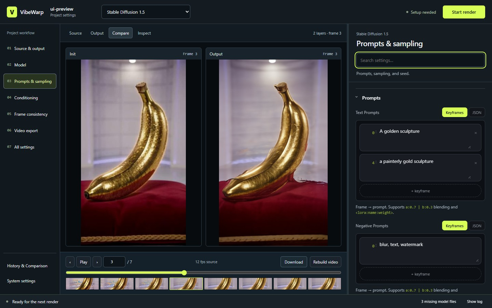
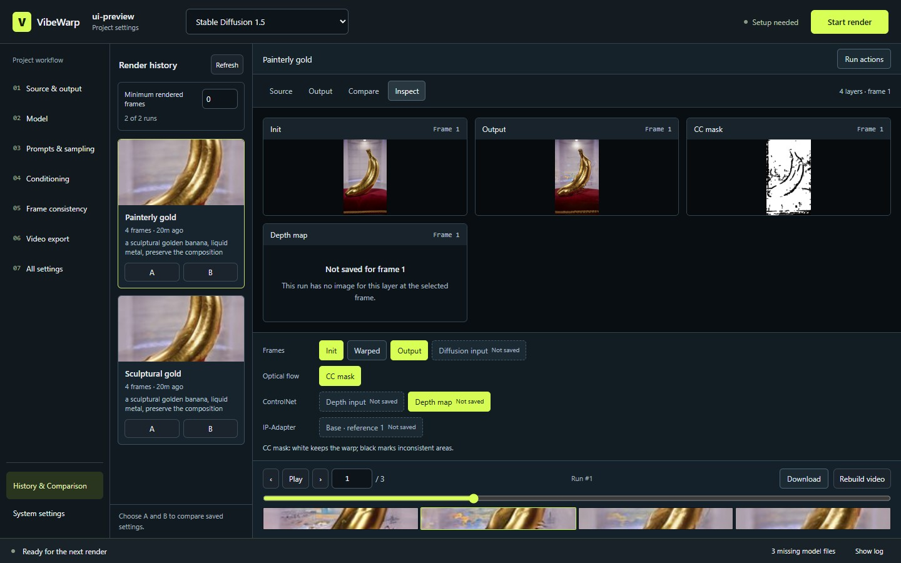

# VibeWarp — The Impressionism of video2video

[](https://github.com/Sxela/VibeWarp/actions/workflows/ci.yml)

Video-to-video style transfer, consolidated from [WarpFusion](https://github.com/Sxela/WarpFusion) v0.37 into a standalone Python package.

Disco notebook imports preserve the six-step quality/turbo execution controls: repeated CLIP passes, grouped cut batches, merged LoRAs, secondary precision, and source-aspect padded canvases with optional export cropping. See [Disco video settings](docs/disco-video-settings-and-trusted-guidance.md) for configuration and parity limits.

All Disco CLIP and SigLIP guidance encoders load in FP16. The secondary model automatically uses native CUDA BF16 where supported, otherwise FP16 (BF16 on CPU). Older precision settings migrate automatically; no FP32 model execution option is exposed.

Disco notebook imports retain Turbo skip fractions and consistency controls.
Turbo applies intermediate softness to both histories, color-corrects next-frame
feedback, and blends on CUDA with nearest-even byte rounding. See
[Turbo settings](docs/settings.md#turbo-intermediate-strength).

**Guidance → Cutouts** includes a working-size cap to reduce cutout
construction memory (try 1024 px; 0 preserves native behavior). Final cuts still
use each encoder's required input size. Failed/cancelled jobs become terminal
before GPU cleanup, and cleanup errors do not stop the job worker.

Disco cutout schedules use executed inference progress (0–100%), restarting after skipped steps. Overview, innercut and grayscale values hold until the next key; charts show that hold through 100%. Older settings migrate once while preserving their configured run's cut selections. Video export blends adjacent original renders independently using numbered flow caches and consistency masks, before cropping or upscaling. Automatic model preparation preserves explicit relative ControlNet/IP-Adapter paths.

Feeds each frame of a video through Stable Diffusion, warping the previous render forward
along optical flow so every frame builds on the last instead of being redrawn from scratch.
The result is painterly and alive — it drifts, dissolves and reconstitutes.

That texture is the point, not an artefact of it. A video model will give you a clean,
coherent clip; this gives you something that looks made by hand.

Optical flow, consistency masks and ControlNets are the controls for *how much* it holds
together — turn them up for stability, down for dissolve.

## The interface

**FLUX.3 Image Klein**, **MOSS-Image**, and **MiniMax H3 Image** are available
under ComfyUI-managed models, with text/edit mode in Prompts & sampling.
Saved runs restore the generation mode, sampling overrides, model files and ordered references.
Main style/edit prompts live there; extra multi-image role instructions appear
above the reference cards in Conditioning.
MOSS edit mode applies its edit LoRA with ordered references on both conditioning
branches, following the native MOSS node's input convention.
Conditioning also provides tag-size, badge-height and opacity controls for the
optional baked image labels; these affect the actual model reference images.
ComfyUI model-file selections are remembered separately for each model in your browser.
On a fresh install, the UI fills in the checkpoint and encoder for the selected model variant.
All ComfyUI model availability checks use the server's model-list API rather
than local absolute paths, including GGUF files in legacy `unet` folders.
See [setup and requirements](docs/comfy-image-models.md).
Model-file dropdowns pin the suggestion first, then sort server-reported files
by their shared name prefix and alphabetically. Missing suggestions can be
downloaded; local ComfyUI download folders are discovered from its API.
ComfyUI-managed models return their completed image to the shared player and history;
submission/history/image retrieval is covered for every workflow variant.
Disco-only canvas/cropping settings remain saved when switching models and do
not affect validation or exports for other models.

**Render 1 frame**, beside **Start render**, tests the style on the first frame
of the selected range. It uses the current settings and leaves the full range
in the form unchanged. The test run appears in history with normal progress
and cancellation controls.

A local web UI (Svelte + FastAPI), started with `run-ui.bat` / `run-ui.sh`. There is a full
CLI too — see the [CLI reference](docs/cli.md).

The current project name stays centered in the navbar. Click it to edit the
batch name; Enter or blur saves, Escape cancels. Project settings keeps Import,
Export and Reset in a separate menu. Compact screens retain a centered title row.

**Workspace** — a large source/output viewer with a resizable settings inspector.
The workflow runs from **Source & output** through **Model**, **Prompts & sampling**,
**Guidance**, **Conditioning**, **Mask & tint**, **Color match**, **Frame consistency**, and **Video export**. **All settings** exposes
every editable field for the selected model; **System settings** keeps machine paths and
performance separate. Empty workflows and groups hide as model/settings choices change.
Advanced controls open automatically when they contain all the settings in a group.
Download and project-action popovers close as soon as an item is selected.
The dedicated **Mask & tint** tab offers CUDA Robust Video Matting,
foreground/background RGB tints with independent opacity, and a one-frame preview.
Opacity uses 0–1 sliders (1 is fully opaque); previews show validation errors
and discard the previous image when a new attempt starts.
Video frames and masks are cached per video, filling missing overlaps across jobs.
Separate raw-frame PDF/LAB/mean color matching can follow the first stylized frame
or the previous warped render; output color matching keeps its own settings.
The **Guidance** workflow separates General, CLIP guidance, Cutouts, and Advanced
guidance sections. Fixed-seed controls sit beside Seed for every model.
For native Disco and SD/SDXL, **Fixed noise randomness** adds reproducible
per-frame variation without reducing Gaussian noise variance. It ranges from
0 (existing behavior) to 1 (fresh noise after frame zero).
**Noise wiggle shift px** uses 0 for off. Direction `[0,0]` gives random wiggle;
other `[x,y]` vectors roll cumulatively in that direction at the chosen speed.
Use randomness 0 for wraparound translation alone; noise values stay intact.
Disco's init/image scale schedules, secondary model and frame-guidance mask
are directly available in **Guidance / General**.
Frame ranges use extracted-frame indices: with stride 2, range 0–10 extracts
source frames 0, 2, …, 20, retaining video guidance for all eleven render frames.
The persistent model picker groups thirteen variants into **Native
models** and **ComfyUI-managed models**, with Start/Cancel always in reach. The source
video is probed before rendering, and phones use Viewer,
Settings, and Runs views.



**Runs & settings** — every past run, inspectable frame by frame and layer by layer:
the init frame, warped init, processed consistency mask, each ControlNet's source and
detected map, the diffusion input, and the output. **Load settings** and **Resume**
are directly available in the run toolbar. Click the run name to rename it.
The player toolbar switches between **View frames** and **Play video** when a
video exists. The mode switch stays on the left, playback controls are centered,
and export actions stay on the right; narrow panels use separate rows.
Load any run's settings back into the form to iterate on it.
Press play on the frame stepper to loop the rendered frames in
place — judge motion without assembling a video first, including part-way through a
render. Cancelled runs keep their completed frames: resume from the first missing frame,
assemble a partial video at any time, and play assembled videos in place.
Select **A** and **B** on two runs to compare every changed saved setting side by side —
including settings one run predates entirely, which show as **not saved** rather than
silently reading as agreement. The Ctrl/Cmd-click shortcut also remains available.
**Inspect** groups frame layers, CC masks, ControlNet maps, IP-Adapter references, and
edit-model inputs. Selected layers share one frame control and enlarge on click. Missing
artifacts are labelled explicitly; phones display one selected layer at a time. The
timeline includes **Download** for the current image or assembled video and **Make video**.



## Documentation

- [CLI reference](docs/cli.md) — all flags, usage examples, model downloads, Python API, output layout
- [Settings reference](docs/settings.md) — WarpFusion settings mapping, schedules, consistency masks, video assembly, tiled VAE, noise modes, prompts/LORAs, vendored libraries
- [Architecture](docs/architecture.md) — render pipeline, settings flow, and dependency diagrams
- [Disco Diffusion and turbo](docs/disco-diffusion.md) — classic pixel diffusion, guidance encoders, download progress, and flow turbo
- [GPU validation](docs/gpu-validation.md) — resumable notebook-parity suite and bulk reports
- [Roadmap and known gaps](docs/roadmap.md) — what is verified against the notebook, what is not, and where to help

## Requirements

- NVIDIA GPU with CUDA support (8 GB+ VRAM recommended)
- The Windows one-click installer handles Python and ffmpeg for you (see below).
  Linux/macOS and manual installs need Python 3.11+ and ffmpeg on PATH.

## Quickstart

Machine paths stay in local, gitignored `system.json`. For a fresh setup, configure
**System settings** in the UI, or copy [system.example.json](system.example.json)
to `system.json` and edit it. The template uses `.` for the install root, `models`
for model storage, and blank optional overrides. Relative paths assume you launch
from the install folder. Set your own absolute
paths for models stored elsewhere. Existing installations keep their local paths;
the example is never applied automatically.

### 1. Install

**One-click (recommended).** On Windows, downloads a private Python 3.14,
ffmpeg/ffprobe, and application dependencies into this folder — nothing touches
your system Python. Linux/macOS uses your installed Python and ffmpeg. Both
installers include the UI dependencies and leave model weights to the UI:

- **Windows**: double-click `install.bat` (or run it from a terminal).
- **Linux/macOS**: `./install.sh`

Re-running is safe: completed steps are skipped. If your CUDA driver isn't
12.8, edit the `torch_index` (`.bat`) / `TORCH_INDEX` (`.sh`) line at the top
first — see https://pytorch.org/get-started/locally/.

<details>
<summary>Manual install (if you already manage your own Python/ffmpeg)</summary>

```bash
# virtual environment
python -m venv env
source env/bin/activate   # Linux/macOS
env\Scripts\activate      # Windows

# PyTorch matching your CUDA driver (example: CUDA 12.8)
pip install torch torchvision --index-url https://download.pytorch.org/whl/cu128

# VibeWarp + remaining dependencies
pip install -e .
```

Install ffmpeg from https://ffmpeg.org/download.html (Windows),
`sudo apt install ffmpeg` (Linux), or `brew install ffmpeg` (macOS).
</details>

Everything else is vendored in `vibewarp/vendor/` — no external git clones
needed.

After the one-click install, use the `run` launcher for everything below — it
activates the private environment and forwards all arguments to VibeWarp:
`run.bat <args>` (Windows) or `./run.sh <args>` (Linux/macOS). With a manual
install, use `python -m vibewarp <args>` inside your activated venv instead.

### 2. Get models

Open `run-ui.bat` (Windows) or `./run-ui.sh` (Linux/macOS), choose a model and
input video, then configure your settings. Use **Download required models**
to prepare missing files, or **Start render** to prepare them on demand.
Existing files are reused; setup does not download any model weights.
Models without a supported download source still require you to supply their files.

For CLI workflows, the download command remains available and downloads the
checkpoint and ControlNets referenced in a settings file:

```bash
run.bat --download-models --warpfusion-settings path/to/settings.txt
```

Models land in a `models/` folder under the current directory by default;
override with `--models-root`. See [docs/cli.md](docs/cli.md) for manual
download links.

The FLUX.2, HiDream, Qwen Image Edit, and Mage-Flow Edit backends require a
separate, current ComfyUI install.
Get it from the [official ComfyUI download page](https://www.comfy.org/download)
and update it before installing the models; these backends use native ComfyUI
nodes. Portable and manual-install users can use the
[official GitHub repository](https://github.com/Comfy-Org/ComfyUI).

Sequential SD, SDXL, Disco and ComfyUI image renders can use the previous
sample to guide denoising in flow-consistent areas. Enable it under **Frame
consistency → Temporal guidance**. The Klein experiment used strength `0.2`
from 10% to 85% of the steps. [Settings and ComfyUI node setup](docs/settings.md#flow-masked-temporal-guidance).

For the experimental FLUX.2 Klein Edit path, start ComfyUI separately with its
Klein diffusion model, matching Qwen text encoder, and Flux2 VAE installed.
Select `model_version="flux2_klein_edit"` for 4B or
`model_version="flux2_klein_9b_edit"` for 9B; VibeWarp connects to
`http://127.0.0.1:8188` by default. The server URL and Comfy-visible model
filenames are configurable under **System → Paths**. See
[Flux 2 Klein Edit setup and settings](docs/settings.md#flux-2-klein-edit) for
the exact Hugging Face downloads and destination folders.

For experimental pixel-space editing with HiDream-O1, put
`hidream_o1_image_fp8_scaled.safetensors` in ComfyUI's `models/checkpoints`
folder and select `model_version="hidream_o1_edit"`. No disjoint text encoder
is required for direct prompts; ComfyUI's optional Gemma 4 model is a prompt
enhancer, not the model's core conditioning encoder. See
[HiDream-O1 setup and settings](docs/settings.md#hidream-o1-edit) for the exact
Hugging Face download and destination folder.

For Qwen Image Edit 2511, install the INT8 ConvRot diffusion model, Qwen 2.5 VL
encoder, Qwen image VAE, and the default LightX2V 8-step Lightning LoRA in
ComfyUI, then select
`model_version="qwen_image_edit_2511"`. To compare the lower-VRAM Q5_K_M
transformer with identical edit settings, install ComfyUI-GGUF, place
`Qwen-Image-Edit-2511-Q5_K_M.gguf` in `models/unet`, and select
`model_version="qwen_image_edit_2511_gguf"`. See
[Qwen Image Edit 2511 setup and settings](docs/settings.md#qwen-image-edit-2511)
for the exact Hugging Face folders and filenames.

For Microsoft's 4B Mage-Flow Edit, install the Comfy-Org INT8 ConvRot
transformer, Qwen3-VL 4B encoder, and Mage VAE. Select
`model_version="mage_flow_edit"` for the 30-step RL-aligned model or
`model_version="mage_flow_edit_turbo"` for the 4-step distilled model. See
[Mage-Flow Edit setup and settings](docs/settings.md#mage-flow-edit).

FLUX.2, HiDream, Qwen, and Mage share the same ordered **Reference Images**
editor. The first image is always present; optional later images can use raw or
temporal frames, or an uploaded style reference selected through the square
drag-and-drop picker.

### 3. Render with your WarpFusion settings

Use a settings file exported from the WarpFusion notebook as-is — the models
root is auto-inferred from the checkpoint path in the file:

```bash
run.bat --warpfusion-settings path/to/settings.txt --video input.mp4
```

Optionally override resolution or frame range on top of the settings:

```bash
run.bat --warpfusion-settings settings.txt --video input.mp4 --max-size 768 --end-frame 30
```

Rendered frames and the assembled video appear under
`images_out/<batch-name>/<run>/` ([details](docs/cli.md#output-layout)).

### Web UI

A Svelte web UI is available via `run-ui.bat` (Windows) / `./run-ui.sh`
(Linux/macOS). The installer includes the lightweight FastAPI server from the
`[ui]` extra; the launcher also repairs missing UI dependencies in older installs.
It opens http://localhost:7860. The form is generated
from `RunConfig`, with full config import/export, validation, queued rendering,
live progress and logs, cancellation/resume, partial video assembly and playback, and
artifact previews.

Prefill the UI from structured JSON, a VibeWarp settings snapshot, or a
WarpFusion notebook settings file:

```bash
vibewarp-ui --settings path/to/settings.txt
```

The same files can be selected with **Import settings** in the project menu after the UI
opens. Export and reset are in that menu too. Disco 256 is no longer offered in the UI;
legacy settings remain readable, with a supported model selection required before rendering.

Prompt and numeric schedules always show their keyframes. Frame 0 is the constant
case; copy/paste icons transfer JSON without hiding values behind mode switches.
Nested per-step ramps stay editable as JSON. Explanatory hints are available from
the keyboard-accessible **?** controls; validation errors stay beside their fields.

The persistent **Workspace / Runs** switch keeps saved runs accessible in narrower
desktop windows. **Hide settings** gives the images more room. **Source / output**
compares frames; **Compare settings** compares the saved settings of runs A and B.
The empty source pane opens and focuses the input video field. Reconnecting to a
render restores its submitted viewer context while preserving your next-render draft.
After the render finishes, **View draft** returns the viewer to that draft.
The Model tab's **Support VibeWarp** category starts expanded, with supporter
credits and the Patreon link visible.

Drag the top edge of the system log to expand it; its height is remembered.
The render status shows ETA from the outer render progress log, separately from
per-frame denoising progress.

In **Mask & tint**, **Apply masked tint** colors raw inputs while **Use
Background Mask** composites the render image **before diffusion** or **after
diffusion**. **Mask source** picks RVM matting (generated on the GPU, also when tint
is off) or your own mask video / image folder; video export masking uses the same
masks. Render masking is applied once at the selected stage, outside the warp step.
**Mask & tint** contains only RVM masking and tint controls, plus RVM file overrides.
Raw-input color matching lives in **Color match**. Consistency masks stay in
**Frame consistency / Flow & Consistency**, guidance masks in **Guidance / General**,
Disco inpainting masks in **Prompts & sampling**, and output masks in **Video export**.
ControlNet/IP-Adapter masks remain in **Conditioning**. See the
[remaining duplicate editors](docs/settings-duplicates.md).
The remaining [All-settings-only fields](docs/settings-workflow-audit.md) are
listed for the next navigation pass.

For Disco 512, enabling quality/turbo LoRAs preserves your secondary-model,
guidance, prompt, and sampling settings. Choose those settings explicitly;
the UI no longer changes them when an adapter is enabled.

In **Source & output**, the frame range is the only render limit: 0–10 renders
11 frames. Old profile frame counts migrate into that range during import;
they cannot override later range edits. There is no separate frame-limit setting.

The **Inspect** viewer replays a finished (or in-progress) run frame by
frame, showing the init video frame, the warped init, each ControlNet's source
image and detected map, the diffusion input, and the rendered output side by
side on a frame slider — so you can see exactly what a ControlNet was fed and
what it produced.

Cancelling does not discard rendered frames. In **Runs & settings**, use **Resume**
to continue the same run with its previous stylized frame restored, or **Make video** to
encode only the frames completed so far. **Play video** opens the result in the app.

The ControlNet panel lists every net the engine supports for your base model
(SD1.5 / SDXL), scans the model directory and tells you which checkpoints are
actually present *before* you start a render. See
[docs/settings.md](docs/settings.md#controlnet-modes-and-layer-weights) for how
the ControlNet `mode` relates to layer weights.

Editing the frontend requires a rebuild — the Svelte app is compiled into
`vibewarp/web_static/`, which is what the server actually serves:

```bash
cd webui && npm install && npm run build
```

## License

GPL-3.0 — see [LICENSE](LICENSE). Vendored third-party components are
in [THIRD_PARTY_LICENSES.md](THIRD_PARTY_LICENSES.md).

Based on [WarpFusion](https://github.com/Sxela/WarpFusion) by Alex Spirin (MIT).

## Contributing and security

See [CONTRIBUTING.md](CONTRIBUTING.md) for the development setup and test commands.
The test guide also explains render-path skips when CUDA devices are unavailable or hidden.
Please report vulnerabilities using the private process in [SECURITY.md](SECURITY.md).
